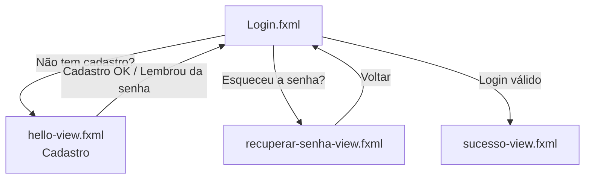
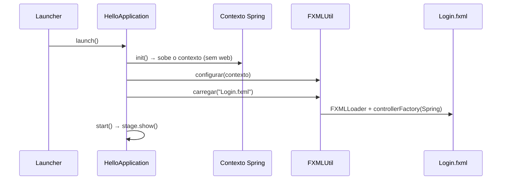

<div align="center">

# 🔐 ACESSO+ — Cadastro de Funcionários

**Aplicação desktop para cadastro e autenticação de funcionários, com interface moderna em JavaFX, persistência em MySQL e senhas protegidas com BCrypt.**


</div>

---

## 📑 Sumário

- [Sobre o projeto](#-sobre-o-projeto)
- [Funcionalidades](#-funcionalidades)
- [Tecnologias](#-tecnologias)
- [Arquitetura](#-arquitetura)
- [Estrutura de pastas](#-estrutura-de-pastas)
- [Como executar](#-como-executar)
- [Configuração](#%EF%B8%8F-configuração)
- [Modelo de dados](#-modelo-de-dados)
- [Segurança](#-segurança)
- [Roadmap](#-roadmap)
- [Problemas conhecidos](#-problemas-conhecidos)
- [Contribuindo](#-contribuindo)
- [Licença](#-licença)

---

## 📌 Sobre o projeto

O **ACESSO+** é uma aplicação desktop que combina o melhor de dois mundos: uma interface rica feita com **JavaFX** e uma camada de negócio/persistência robusta usando **Spring Boot** (sem servidor web) com **Spring Data JPA**.

O projeto implementa o fluxo completo de **cadastro → login → área logada**, seguindo uma arquitetura em camadas (`controller` → `service` → `repository` → `entity`) e utilizando **injeção de dependência do Spring dentro dos controllers do JavaFX** — o que permite que os controllers das telas usem `@Component` e recebam os *services* por construtor, como em qualquer aplicação Spring.

> 💡 **Destaque técnico:** o `FXMLUtil` configura o `FXMLLoader` com `setControllerFactory(contexto::getBean)`, integrando o ciclo de vida do JavaFX com o contexto do Spring.

---

## ✨ Funcionalidades

| Recurso | Descrição |
|---|---|
| 📝 **Cadastro de funcionário** | Nome, sobrenome, e-mail e senha, com validação de campos obrigatórios e formato de e-mail. |
| 🔑 **Login** | Autenticação por e-mail e senha, comparando o hash BCrypt armazenado no banco. |
| 👁️ **Mostrar/ocultar senha** | Checkbox que alterna entre `PasswordField` e `TextField` na tela de login. |
| ⌨️ **Atalho de teclado** | Pressionar `Enter` no campo de senha visível dispara o login. |
| 🔁 **Recuperação de senha** | Tela de solicitação com validação do e-mail *(envio de link/código ainda em desenvolvimento)*. |
| ✅ **Tela de sucesso** | Confirmação de login com alerta de boas-vindas. |
| 🚫 **E-mail único** | Impede cadastros duplicados (verificação no serviço + *unique constraint* no banco). |
| 🔔 **Alertas padronizados** | Classe `TelaDeAviso` centraliza mensagens de erro, aviso e sucesso. |
| 🎨 **Tema escuro** | Interface estilizada via CSS inline do JavaFX, com painel lateral de identidade visual. |

---

## 🛠️ Tecnologias

- **Linguagem:** Java 17+ *(recomendado: Java 21, alinhado ao JavaFX 21)*
- **Interface:** JavaFX 21 + FXML
- **Framework:** Spring Boot 3.x (`WebApplicationType.NONE`)
- **Persistência:** Spring Data JPA / Hibernate
- **Banco de dados:** MySQL 8 *(configuração alternativa para PostgreSQL comentada)*
- **Segurança:** `spring-security-crypto` (`BCryptPasswordEncoder`)
- **Utilitários:** Lombok
- **Build:** Maven

---

## 🏗️ Arquitetura

### Camadas

```mermaid
flowchart LR
    A[FXML<br/>Telas JavaFX] --> B[Controllers<br/>@Component]
    B --> C[FuncionarioService<br/>@Service]
    C --> D[FuncionarioRepository<br/>Spring Data JPA]
    D --> E[(MySQL)]
    C --> F[PasswordEncoder<br/>BCrypt]
```

### Fluxo de navegação



### Inicialização



---

## 📂 Estrutura de pastas

```
src/main
├── java/com/stilinsky/cadastro_de_funcionarios
│   ├── AplicacaoSpring.java          # Configuração Spring Boot (scan + JPA repositories)
│   ├── HelloApplication.java         # Entrada JavaFX: sobe o Spring e abre a tela de login
│   ├── Launcher.java                 # Main "wrapper" para executar fora de módulos
│   ├── FXMLUtil.java                 # Carrega FXML usando beans do Spring como controllers
│   │
│   ├── config/
│   │   └── PasswordConfig.java       # Bean do PasswordEncoder (BCrypt)
│   │
│   ├── controller/
│   │   ├── HelloController.java      # Tela de cadastro
│   │   ├── LoginController.java      # Tela de login
│   │   ├── RecuperarSenhaController.java
│   │   ├── SucessoController.java
│   │   └── TelaDeAviso.java          # Alertas padronizados (erro / aviso / sucesso)
│   │
│   ├── entity/
│   │   └── Funcionario.java          # Entidade JPA
│   │
│   ├── repository/
│   │   └── FuncionarioRepository.java
│   │
│   └── service/
│       ├── FuncionarioService.java   # Regras de negócio: cadastrar / autenticar
│       └── EmailValido.java          # Validação de formato de e-mail
│
└── resources
    ├── application.properties
    └── com/stilinsky/cadastro_de_funcionarios
        ├── Login.fxml
        ├── hello-view.fxml           # Tela de cadastro
        ├── recuperar-senha-view.fxml
        └── sucesso-view.fxml
```

---

## 🚀 Como executar

### Pré-requisitos

- [JDK 17+](https://adoptium.net/) (recomendado JDK 21)
- [Maven 3.9+](https://maven.apache.org/) *(ou use o wrapper do projeto, se houver)*
- [MySQL 8](https://dev.mysql.com/downloads/) — ou Docker, para subir o banco rapidamente

### 1. Clone o repositório

```bash
git clone https://github.com/<seu-usuario>/<seu-repositorio>.git
cd <seu-repositorio>
```

### 2. Suba o banco de dados

**Opção A — Docker (recomendado):**

```bash
docker run -d \
  --name mysql-acesso \
  -e MYSQL_ROOT_PASSWORD=<senha_root> \
  -e MYSQL_DATABASE=cadastroteste \
  -e MYSQL_USER=<usuario> \
  -e MYSQL_PASSWORD=<senha> \
  -p 1112:3306 \
  mysql:8
```

**Opção B — MySQL local:** crie o banco manualmente.

```sql
CREATE DATABASE cadastroteste CHARACTER SET utf8mb4 COLLATE utf8mb4_unicode_ci;
```

> A tabela `funcionarios` é criada automaticamente na primeira execução (`spring.jpa.hibernate.ddl-auto=update`).

### 3. Configure as credenciais

Veja a seção [Configuração](#%EF%B8%8F-configuração). A forma recomendada é por **variáveis de ambiente**, sem editar o `application.properties`.

### 4. Execute

**Pela IDE (IntelliJ / Eclipse / VS Code):** execute a classe `Launcher`.

**Pelo Maven** *(requer o `javafx-maven-plugin` configurado no `pom.xml`)*:

```bash
mvn clean javafx:run
```

> ℹ️ A classe `Launcher` existe para contornar a restrição do JavaFX ao iniciar uma classe que estende `Application` diretamente fora do *module path*. Use-a como *main class* também ao gerar um JAR executável.

---

## ⚙️ Configuração

Configuração padrão em `src/main/resources/application.properties`:

```properties
spring.docker.compose.enabled=false

spring.datasource.url=jdbc:mysql://localhost:1112/cadastroteste
spring.datasource.username=<usuario>
spring.datasource.password=<senha>
spring.datasource.driver-class-name=com.mysql.cj.jdbc.Driver

spring.jpa.hibernate.ddl-auto=update
spring.jpa.show-sql=true
```

### 🔒 Sobrescrevendo com variáveis de ambiente (recomendado)

O Spring Boot converte variáveis de ambiente em propriedades automaticamente. Assim, **nenhuma credencial precisa ficar no repositório**:

**Linux / macOS**

```bash
export SPRING_DATASOURCE_URL="jdbc:mysql://localhost:1112/cadastroteste"
export SPRING_DATASOURCE_USERNAME="seu_usuario"
export SPRING_DATASOURCE_PASSWORD="sua_senha"
```

**Windows (PowerShell)**

```powershell
$env:SPRING_DATASOURCE_URL="jdbc:mysql://localhost:1112/cadastroteste"
$env:SPRING_DATASOURCE_USERNAME="seu_usuario"
$env:SPRING_DATASOURCE_PASSWORD="sua_senha"
```

### 🐘 Usando PostgreSQL

O `application.properties` já traz um bloco comentado para PostgreSQL. Para usá-lo:

1. Adicione a dependência `org.postgresql:postgresql` ao `pom.xml`.
2. Comente o bloco do MySQL e descomente o do PostgreSQL.
3. Defina `DATABASE_URL`, `DATABASE_USERNAME` e `DATABASE_PASSWORD`.

---

## 🗄️ Modelo de dados

Tabela **`funcionarios`**:

| Coluna | Tipo | Restrições |
|---|---|---|
| `id` | `BIGINT` | PK, `AUTO_INCREMENT` |
| `nome` | `VARCHAR(100)` | `NOT NULL` |
| `sobrenome` | `VARCHAR(100)` | `NOT NULL` |
| `email` | `VARCHAR(180)` | `NOT NULL`, **UNIQUE** (`uk_funcionarios_email`) |
| `senha_hash` | `VARCHAR(100)` | `NOT NULL` — hash BCrypt |
| `data_cadastro` | `DATETIME` | `NOT NULL`, preenchida via `@PrePersist` |

---

## 🛡️ Segurança

- **Senhas nunca são salvas em texto puro** — apenas o hash gerado pelo `BCryptPasswordEncoder`.
- **Normalização de e-mail:** o e-mail é salvo em minúsculas e sem espaços; buscas usam `IgnoreCase`.
- **Unicidade garantida em duas camadas:** `existsByEmailIgnoreCase` no serviço + *unique constraint* no banco.
- **Mensagem genérica no login:** o erro "E-mail ou senha incorretos" não revela se o e-mail existe.
- **Transações:** `@Transactional` no cadastro e `@Transactional(readOnly = true)` na autenticação.

> ⚠️ **Nunca versione credenciais reais.** Prefira variáveis de ambiente ou um arquivo `application-local.properties` listado no `.gitignore`.

---

## 🗺️ Roadmap

- [x] Cadastro de funcionários com validação
- [x] Login com senha criptografada (BCrypt)
- [x] Alternância de visibilidade da senha
- [x] Tela de recuperação de senha (interface)
- [ ] Envio real de link/código de recuperação por e-mail
- [ ] Limite de tentativas de login *(já existe o alerta `mensagemDeExcessosDeTentativas`)*
- [ ] Sessão do usuário logado e tela principal (dashboard)
- [ ] CRUD completo de funcionários (listar, editar, excluir)
- [ ] Perfis/permissões (admin, RH, colaborador)
- [ ] Migrations com Flyway ou Liquibase (substituir `ddl-auto=update`)
- [ ] Testes unitários e de integração (JUnit 5 + Testcontainers)
- [ ] Empacotamento nativo com `jpackage` (instalador `.exe` / `.dmg` / `.deb`)
- [ ] Validação de e-mail e política de senha mais fortes

---

## 🐞 Problemas conhecidos

| Item | Detalhe |
|---|---|
| Ícone da janela | O caminho `img/Logotipo.png/` em `HelloApplication` termina com `/` e é relativo à classe; por isso o ícone pode não carregar. |
| Pacote do `EmailValido` | O arquivo está em `service/`, mas declara o pacote `service.funcions_extra`. Funciona na compilação, porém IDEs podem acusar divergência — alinhe pasta e pacote. |
| Recuperação de senha | Apenas valida o e-mail e exibe um aviso; ainda não envia nada. |
| Título dos alertas | `TelaDeAviso` usa "Erro de Login" também para avisos de cadastro. |

---

## 🤝 Contribuindo

Contribuições são bem-vindas!

1. Faça um *fork* do projeto
2. Crie uma branch: `git checkout -b feature/minha-feature`
3. Faça o commit: `git commit -m "feat: adiciona minha feature"`
4. Envie para o seu fork: `git push origin feature/minha-feature`
5. Abra um **Pull Request**

Sugestão de padrão para commits: [Conventional Commits](https://www.conventionalcommits.org/pt-br/).

---

## 📄 Licença

Distribuído sob a licença **MIT**. Veja o arquivo `LICENSE` para mais informações.
*(Se ainda não houver um `LICENSE` no repositório, adicione um ou ajuste esta seção.)*

---

<div align="center">

Desenvolvido por **Stilinsky** 💙

</div>